<div align="center">

# 🔐 Cybersecurity Lab Environment Setup

**Building my own isolated virtual lab for ethical hacking and penetration testing practice**
</div>

<p align="center">
  
  
  
  
  
  
  
  
  
</p>

---

## 📌 Project Overview

This project documents how I built a **virtual cybersecurity testing lab** on my own computer using VirtualBox and Kali Linux, as my Week 1 project in the Networkwalks Cybersecurity Internship.

The lab gives me a safe, isolated place to practice security skills without touching any real systems. It runs on a private virtual network, so more machines can be added later and used as targets for authorized testing.

**Intern:** YOUR NAME  |  **Batch:** YOUR BATCH  |  **Task:** WK1-PM1

---

## 🎯 Objectives

- Install VirtualBox as the virtualization base.
- Import Kali Linux as the attacker machine.
- Create a private NAT Network in the `10.0.0.0/24` subnet.
- Give the Kali VM the static address `10.0.0.2/24` with full Internet access.
- Enable clipboard and drag & drop between the host and the VM.
- Share the host's Downloads folder with the VM.
- Save a clean snapshot to restore at any time.
- Document the whole process with screenshots.

---

## 🛡️ Purpose of the Lab

This lab is my controlled environment for learning and practicing, for example:

- Network reconnaissance and port scanning
- Vulnerability assessment
- Packet analysis
- Web security testing
- Trying out security tools

⚠️ **Important:** Everything in this project was done inside my own lab on a device I own. The lab must only be used on systems you own or have written permission to test.

---

## 🏗️ Lab Architecture

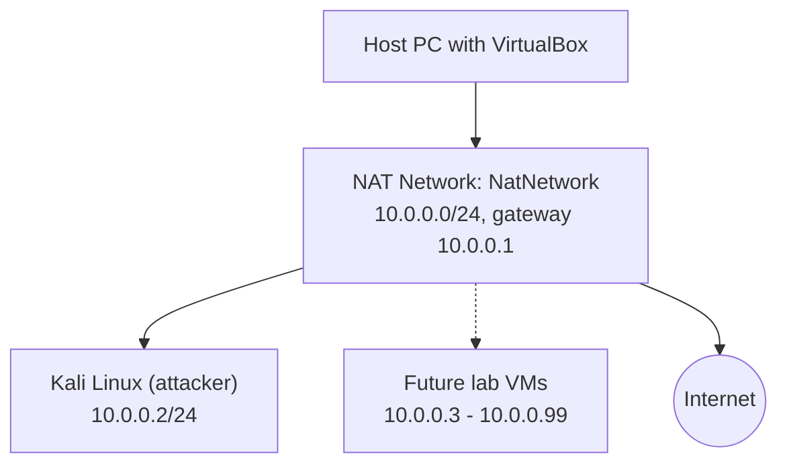

---

## ⚙️ Lab Configuration

| 🧩 Component | ⚙️ Configuration |
| --- | --- |
| 🖥️ Host OS | YOUR HOST OS (e.g. Windows 11) |
| 🧠 Host RAM | YOUR HOST RAM (e.g. 8 GB) |
| ⚡ Processor | YOUR PROCESSOR (e.g. Intel Core i5) |
| 🧰 Hypervisor | VirtualBox VERSION |
| 🐉 Guest OS | Kali Linux VERSION |
| 🧠 Kali RAM | 4096 MB |
| 💾 Kali Disk | about 130 GB (dynamic) |
| 🌐 Virtual Network | NAT Network (`NatNetwork`) |
| 📡 Network Address | 10.0.0.0/24 |
| 🐧 Kali IP Address | 10.0.0.2/24 |
| 🚪 Default Gateway | 10.0.0.1 |
| 🌍 DNS Server | 8.8.8.8 |

---

# 🪜 Lab Setup Procedure

## Step 1. Install 7-Zip

I downloaded 7-Zip from the official site. It is needed to extract the compressed Kali VM package.

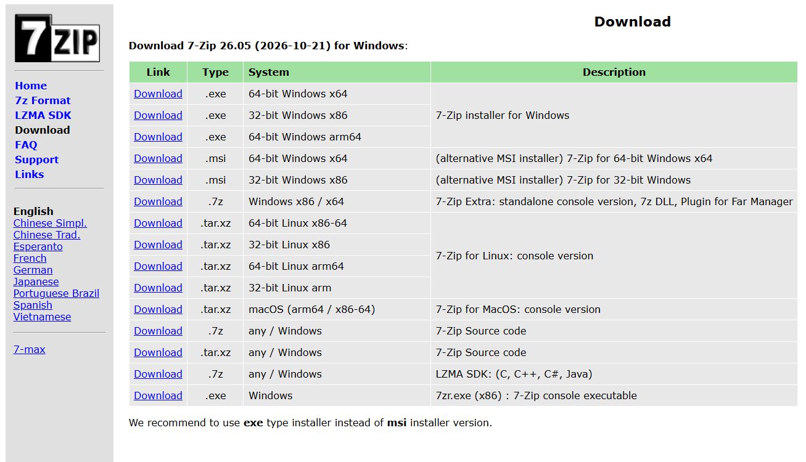

---

## Step 2. Install VirtualBox

I downloaded the latest VirtualBox from the official site and installed it with the default options.

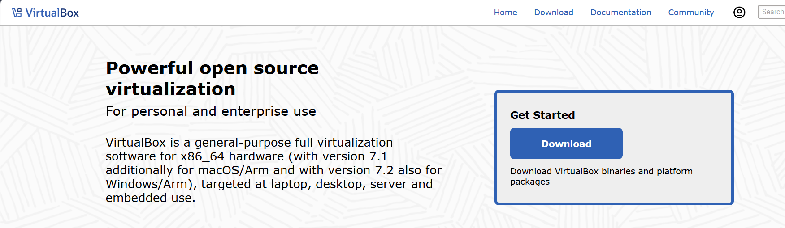


---

## Step 3. Create the NAT Network

In VirtualBox I opened **File → Tools → Network → NAT Networks** and created a network with:

```text
Name:        NatNetwork
IPv4 Prefix: 10.0.0.0/24
DHCP:        Enabled
IPv6:        Disabled
```

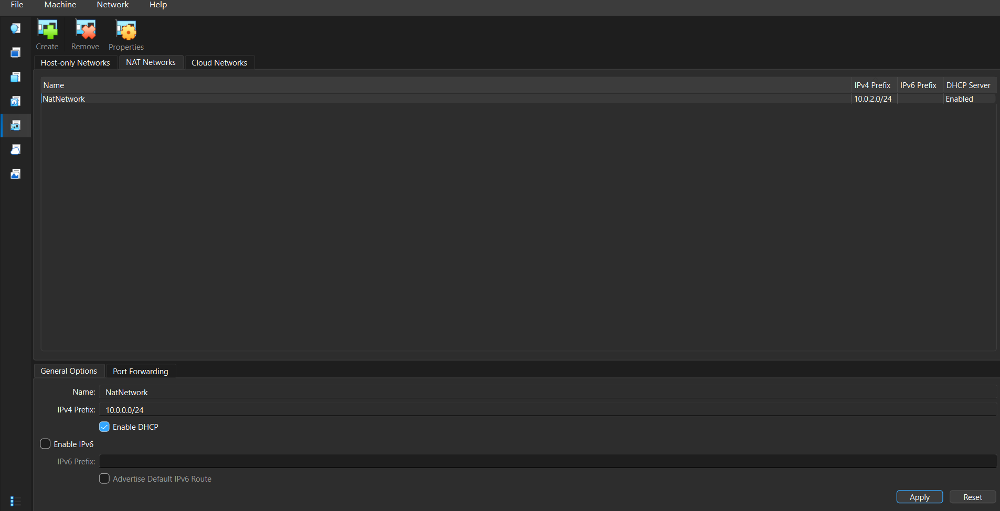

I chose a **NAT Network** because VMs on the same NAT Network can talk to each other and still reach the Internet. That is what a multi-machine lab needs.

---

## Step 4. Download and Import Kali Linux

From the official Kali website I downloaded the pre-built **Virtual Machines** image for VirtualBox, extracted it with 7-Zip, and opened the `.vbox` file to add it to VirtualBox.

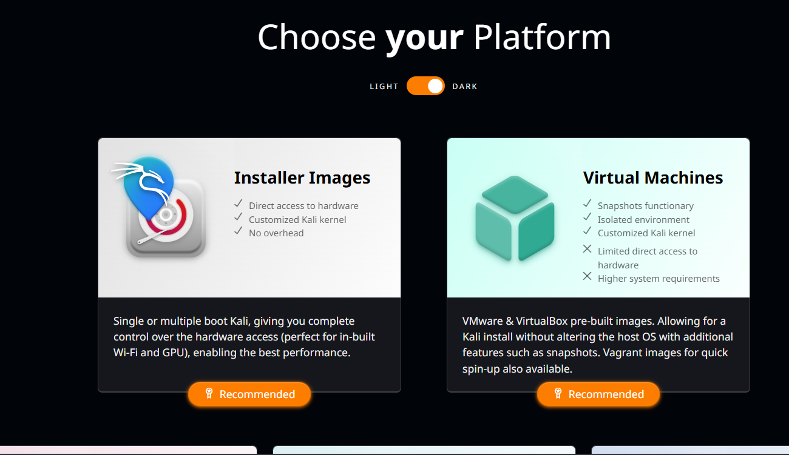
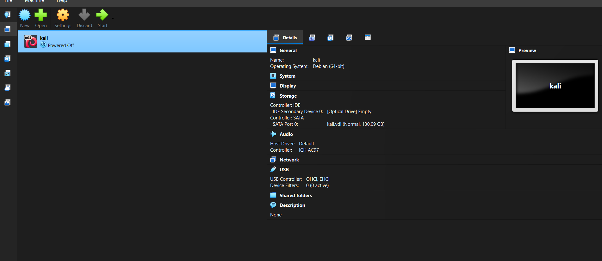

---

## Step 5. Configure the VM Settings

With the VM powered off, I configured the following.

### 5.1 Network adapter

```text
Adapter 1
Attached to:        NAT Network
Name:               NatNetwork
Adapter Type:       Intel PRO/1000 MT Desktop (82540EM)
Promiscuous Mode:   Allow All
Cable Connected:    Yes
```

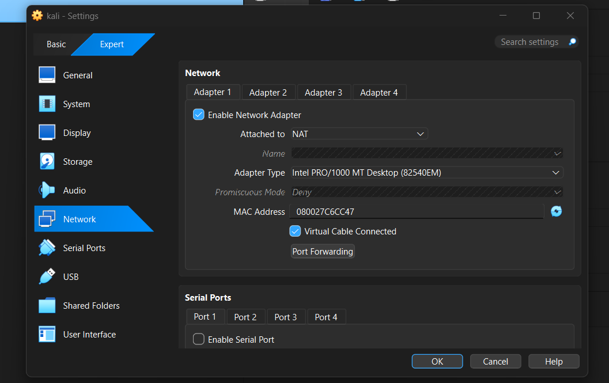

### 5.2 Clipboard and drag & drop

Under **General → Advanced**, I set both **Shared Clipboard** and **Drag'n'Drop** to **Bidirectional**.


### 5.3 Shared folder

I shared the host's Downloads folder with Auto-mount enabled and Full access. Inside Kali it appears under `/media/sf_Downloads`.

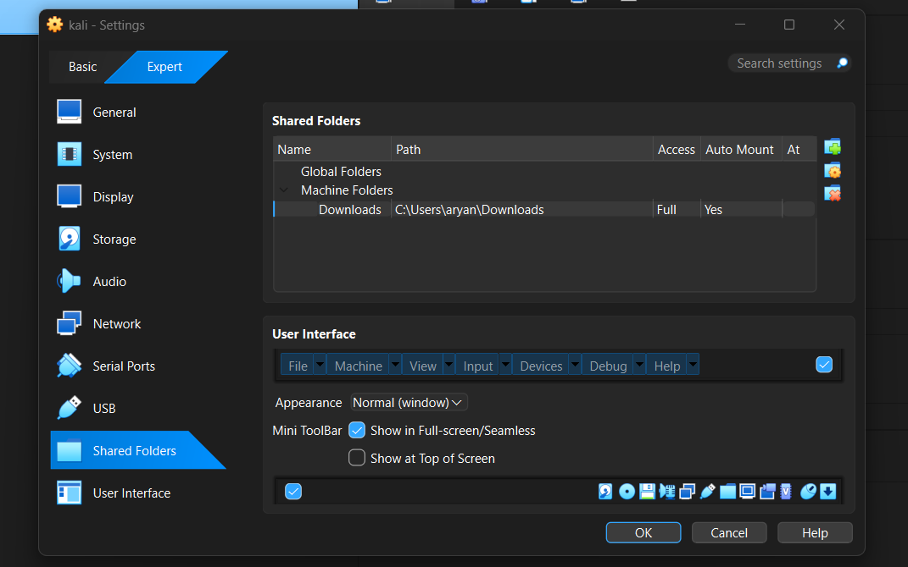


### 5.4 System settings

I gave the VM 4096 MB of memory and kept hardware virtualization (Nested Paging) enabled.

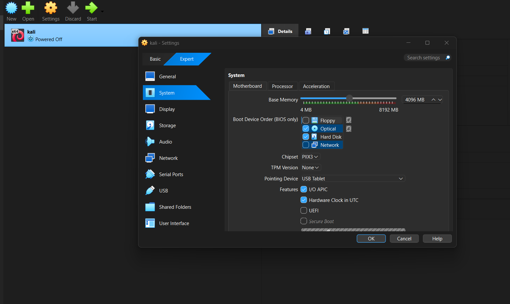
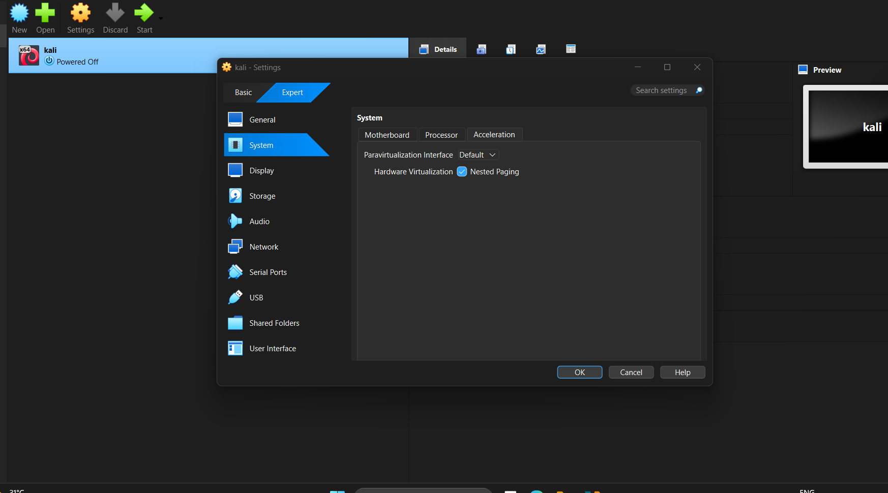

---

## Step 6. Configure the Kali Linux Network

In Kali I edited **Wired connection 1 → IPv4 Settings** and set the method to **Manual**:

```text
IP Address:  10.0.0.2
Netmask:     24 (255.255.255.0)
Gateway:     10.0.0.1
DNS:         8.8.8.8
```

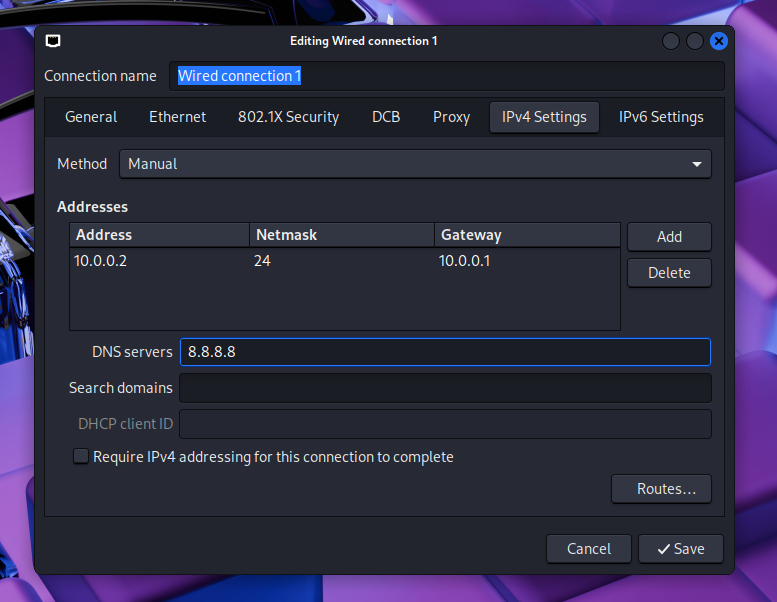

The same configuration from the terminal:

```bash
sudo nmcli connection modify "Wired connection 1" ipv4.method manual ipv4.addresses 10.0.0.2/24 ipv4.gateway 10.0.0.1 ipv4.dns 8.8.8.8 ipv4.dad-timeout 0
sudo nmcli connection down "Wired connection 1"
sudo nmcli connection up "Wired connection 1"
```

A fixed IP makes the lab easier to document and to refer to in later exercises.

---

## Step 7. Create a Clean VM Snapshot

Once everything worked, I took a snapshot in VirtualBox (**Machine → Take Snapshot**).

```text
Snapshot name: Fresh Kali - network setup working
```

This is my clean baseline. If a later experiment breaks the VM, I can restore it in a minute.


---

# 🔎 Lab Verification

| ✅ Test | 🧾 Command | 🎯 Expected result |
| --- | --- | --- |
| 🌐 Check IP address | `ip a` | Shows `10.0.0.2/24` |
| 📡 Test gateway | `ping -c 4 10.0.0.1` | Successful replies |
| 🌍 Test Internet by IP | `ping -c 4 8.8.8.8` | Successful replies |
| 🔎 Test DNS | `ping -c 4 google.com` | Domain resolves and replies |


---

# 🐞 Problems Encountered & Solutions

The setup went smoothly and I did not run into any major problems. To help other students, these are the common issues with this lab and how to fix them:

| Issue | Fix |
| --- | --- |
| Kali has no Internet after setting a static IP | Run the `nmcli` commands from Step 6 (especially `ipv4.dad-timeout 0`), restart Kali, and try `10.0.0.1` as the DNS server if needed. |
| Another VM uses the same IP | Make sure no other VM on the NAT Network has `10.0.0.2`. |
| Adapter shows plain *NAT* | In VM Settings → Network, set Attached to **NAT Network** and pick `NatNetwork`. |
| NAT Network list shows the default prefix | After typing `10.0.0.0/24`, click **Apply** and check that the list updated. |
| Shared folder permission denied in Kali | Run `sudo usermod -aG vboxsf kali` and reboot. |

> Connection names can differ between systems, so check yours first with `nmcli connection show` before running the commands.

---

# 💡 What I Learned

### 1. NAT vs NAT Network
A plain NAT keeps each VM isolated from the others, while a NAT Network lets VMs on the same virtual network talk to each other and still reach the Internet. That makes it the right choice for a lab with several machines.

### 2. Virtual machine networking
I learned how VirtualBox network adapters connect VMs to different networks, and how one small setting can decide whether the whole lab works.

### 3. Static IP configuration
I practiced setting and verifying an IPv4 address, netmask, gateway and DNS in Kali Linux.

### 4. Snapshots
A clean snapshot taken before experimenting is a safe recovery point, so I can try things without fear of breaking the lab.

### 5. Documentation
Writing down the steps, settings and screenshots makes a project repeatable and is an important professional habit.

---

# 🔐 Security & Ethical Use

This lab is for education and authorized practice only. Hacking is legal only on systems you own, or where you have written permission from the owner. I used only my own isolated lab.

---

# 🔗 Tools & Resources

- **7-Zip:** [https://7-zip.org/download.html](https://7-zip.org/download.html)
- **VirtualBox:** [https://virtualbox.org/wiki/Downloads](https://virtualbox.org/wiki/Downloads)
- **Kali Linux:** [https://kali.org/get-kali](https://kali.org/get-kali)

---

# 👤 Author

**YOUR NAME**\
Cybersecurity Intern, Batch YOUR BATCH

LinkedIn: [YOUR LINKEDIN PROFILE URL](https://www.linkedin.com/in/aryan-chavan-a5a637365/)

---

## 📌 Project Information

**Program:** Cybersecurity Internship at Networkwalks | **Week:** 01 | **Project:** WK1-PM1 Cybersecurity Lab Setup | **Repository:** GitHub
